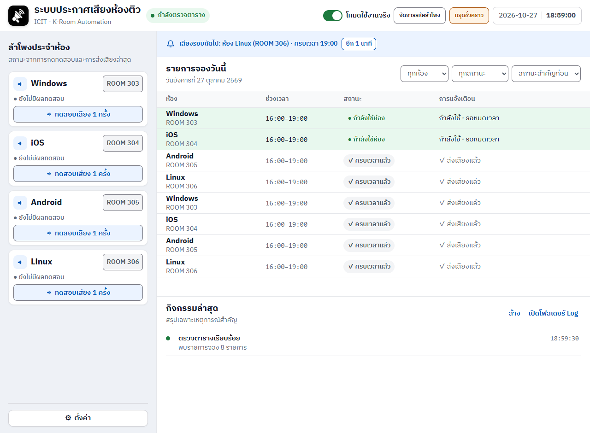

# LabBoy Coworking Broadcast

โปรแกรม Windows สำหรับเจ้าหน้าที่เคาน์เตอร์ อ่านการจองวันนี้จาก K‑Room และประกาศเสียงเมื่อห้องที่เคยพบสถานะ “กำลังใช้ห้อง” ครบเวลาจอง

หน้าต่างใช้ HTML/CSS/JavaScript ผ่าน pywebview, ฟอนต์ IBM Plex Sans Thai และ Python monitor แยก process



## เปิดใช้งาน

1. เก็บ `labboy_coworking_broadcast.exe` และ `room_speaker_monitor.exe` ไว้ด้วยกันในโฟลเดอร์ที่เขียนไฟล์ได้
2. เปิด `labboy-coworking-broadcast.bat` หรือ shortcut เดิมบน Desktop
3. ครั้งแรก ให้ตั้งค่าห้อง/IP/Audio ID และบันทึกรหัสผ่านลำโพงในหน้าตั้งค่า
4. ครั้งต่อไป เมื่อมีรหัสที่บันทึกไว้ แอปจะเริ่มโหมดใช้งานจริงให้อัตโนมัติ

เครื่องต้องมี Microsoft Edge สำหรับอ่าน K‑Room และ Microsoft Edge WebView2 Runtime สำหรับหน้าต่างโปรแกรม รุ่น EXE ไม่ต้องติดตั้ง Python

หากใช้ source code ให้ติดตั้ง Python 3.11 และรัน `ติดตั้งส่วนประกอบ.bat` ก่อนเปิดโปรแกรม

## หน้าจอและการใช้งาน

- แถบด้านบนบอกสถานะระบบ, โหมดปัจจุบัน, ปุ่มจัดการรหัส และปุ่มหยุด/ทำงานต่อ
- แถบ “เสียงรอบถัดไป” บอกรายการที่เข้าเงื่อนไขและเวลาคงเหลือ; เมื่อหยุดระบบจะไม่มีรายการรอประกาศบนแถบนี้
- ตารางเรียงห้องที่กำลังใช้งานก่อน ตามด้วยรายการจองล่วงหน้า และรายการที่ครบเวลาแล้ว
- “การแจ้งเตือน” แสดงผลของแต่ละรอบจอง: ✓ ส่งเสียงแล้ว, – ข้าม, ! ส่งเสียงไม่สำเร็จ
- sidebar แสดงผลทดสอบ/ส่งคำสั่งล่าสุดของแต่ละห้อง ซึ่งไม่ใช่การตรวจว่าลำโพงออนไลน์หรือมีเสียงออกจริง
- ปุ่ม “ทดสอบเสียง 1 ครั้ง” ถามยืนยันก่อนส่งเสียงจริง หากกำลังตรวจตารางอยู่จะหยุดชั่วคราวและตรวจต่อหลังทดสอบ; หากกดหยุดระหว่างทดสอบจะไม่เริ่มต่อเอง
- เปลี่ยนรหัสขณะทำงานได้ โดยเลือกใช้ทันทีผ่านการเริ่มระบบใหม่ หรือใช้เมื่อเริ่มตรวจครั้งถัดไป
- หน้า “ตั้งค่า” แก้ URL ตาราง, ห้อง/IP/Audio ID, เริ่มพร้อม Windows, ถาดระบบ และธีมสว่าง/มืด/คอนทราสต์สูง

## กฎประกาศเสียง

อ่านตารางประมาณทุก 30 วินาที และส่งเสียงเมื่อรายการที่เคยพบเป็น “กำลังใช้ห้อง” สิ้นสุดภายในช่วงเผื่อ 90 วินาที ช่วงเผื่อใช้รับความล่าช้าจากรอบตรวจ ไม่ได้หมายถึงรอเพิ่ม 90 วินาทีก่อนประกาศ

รายการถูกระงับ, ไม่รู้จักสถานะ, ไม่เคยพบว่าเริ่มใช้ห้อง, หรือหมดเวลาเกินช่วงเผื่อจะไม่ถูกสั่งเสียง โปรแกรมใช้ไฟล์ state ป้องกันประกาศซ้ำข้ามการปิด/เปิดแอป

เครื่องต้องเปิดและแอปต้องทำงานอยู่ สามารถซ่อนลงถาดระบบได้ แอปขอไม่ให้ Windows เข้า Sleep ระหว่างตรวจ แต่ Windows Update/รีสตาร์ต/BIOS ยังเป็นนโยบายของหน่วยงาน

## ข้อมูลเฉพาะเครื่อง

- รหัสผ่านอยู่ใน Windows Credential Manager ของบัญชี Windows ที่ใช้งาน ไม่อยู่ใน repository และไม่ส่งกลับไปยังหน้าเว็บ
- URL, ธีม และตัวเลือก startup/tray: `%APPDATA%\labboy-coworking-broadcast\preferences.json`
- ห้อง/IP/Audio ID: `%APPDATA%\labboy-coworking-broadcast\room_devices.json`
- `room_devices.example.json` เป็นตัวอย่างที่เว้น IP ว่าง
- `room_speaker_state.json` และ `logs/room_speaker_monitor.log` อยู่ข้างโปรแกรมและไม่ถูกนำขึ้น Git

ถ้าเปลี่ยน URL หรืออุปกรณ์ขณะ monitor ทำงาน ให้หยุดแล้วเริ่มตรวจใหม่เพื่อใช้ค่าที่บันทึก; ถ้าเว็บเปลี่ยนโครงสร้าง HTML/FullCalendar ต้องปรับตัวอ่านในโค้ดด้วย การเพิ่มชื่อห้องต้องตรงกับชื่อที่เว็บส่งมา

## สร้าง EXE

รัน `สร้างโปรแกรม EXE.bat` บน Windows ที่มี Python และอินเทอร์เน็ต สคริปต์จะสร้าง EXE สองไฟล์ใน `build\release` พร้อมรวมหน้าเว็บ ฟอนต์ และไอคอน

หลังสร้างเสร็จ ดับเบิลคลิก `อัปเดตโปรแกรม.bat` แล้วกด Yes ในหน้าต่างยืนยัน ตัวอัปเดตจะหยุดเฉพาะ LabBoy ของโฟลเดอร์นี้ (รวมตัวตรวจที่ค้างโดยไม่มีหน้าต่าง), สำรอง EXE เดิม, ติดตั้งรุ่นใหม่ และเปิดโปรแกรมต่อให้ ระหว่างอัปเดตจะหยุดประกาศชั่วคราว โดยไม่ลบ state/การตั้งค่า

## ตรวจโค้ดโดยไม่ส่งเสียง

```powershell
py -3 -m unittest discover -s tests -p "test_*.py" -v
node tests/test_booking_model.js
py -3 check_contrast.py
```

ชุดทดสอบจำลอง process/credential/คำสั่งลำโพงทั้งหมด และทดสอบหน้าเว็บใน Edge แบบ headless ไม่เรียกอุปกรณ์จริง

`py -3 tests/smoke_webview.py` เปิดหน้าต่าง WebView จริงชั่วคราวเพื่อตรวจ bridge โดยปิดการอ่านรหัสจริง, startup registration และการเริ่ม monitor

ดูผลตรวจและข้อจำกัดใน [REVIEW.md](REVIEW.md) และแนวทางดูแลใน [DEVELOPMENT.md](DEVELOPMENT.md)
